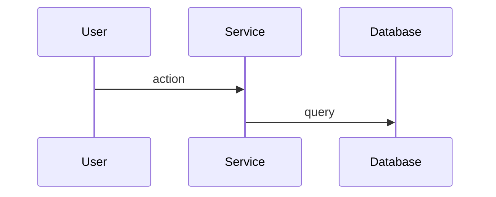

# Architecture — Reference

Long-form guidance, templates, and rationale for the Architecture skill. Read this once before your first run of the skill in a session — the numbered checklist in `SKILL.md` is what you execute against.

## Overview / Input

Design the technical solution at a high level. This is the second gate in the skill chain — it always runs after JTBD, but abbreviates itself when the architecture is obvious.

**Announce at start:** Adapt to the situation:
- If exploring: "I'm using the Architecture skill. I have some design questions before we plan the implementation."
- If obvious: "I'm using the Architecture skill. The approach is straightforward — I'll write up the architecture doc directly."

**Input:**
- PRD from the JTBD skill (in `docs/plans/`)
- Jira epic or ticket from JTBD (when Jira is configured)

If no PRD exists, run the JTBD skill (`workflow:jtbd`) first. It will self-abbreviate for obvious problems, so it won't slow things down.

## Gather Technical Context

Before asking questions, understand the technical landscape:
- Read the PRD and any linked Jira tickets
- Explore relevant repos (structure, existing patterns, tech stack)
- If working from a multi-repo workspace, check child directories for related repos that might be affected
- Check for existing architecture docs, ADRs, or prior art
- Understand what's already built that this work builds on
- **Stale PRD check:** If the PRD was written more than a few days ago, review the current project state and recent commits to check whether the project has drifted significantly. If it has, go back to the JTBD skill (`workflow:jtbd`) to re-validate the PRD before proceeding with architecture.

## Current-State Research

What the design assumes the code does today is checked by an agent that does not know what is
planned. An agent that knows the goal reads the code looking for support for it; one that knows only
the question describes what is there. The `current-state-researcher` agent
(`agents/current-state-researcher.md`) is that agent, and `hooks/current-state-guard.sh` keeps it out
of `docs/plans/`, ticket worktrees, memory and everything outside the working directory.

**When it runs.** On feature work that changes existing behaviour. Skip it when the work is
greenfield or the PRD touches no existing behaviour, and write `No research: greenfield.` (or `No
research: no existing behaviour changes.`) as the architecture doc's Premises section.

**Write the questions.** From the PRD, list what the design will depend on about the code as it is:
what calls something, where a value is stored, what a command does when it fails, which files share a
convention. Each question describes; none proposes. A question never names the ticket, the feature,
the PRD or the change, and never asks what should be done — the agent refuses "how should…" and
"what would it take to…" questions and lists them as refused. Before sending, read each question as
someone who knows nothing of the plan; if it gives the plan away, rewrite it.

**Give it the questions alone.** Hand the current-state researcher, as a short-lived sub-agent, the
numbered questions inline plus the source directories to search, relative to the working
directory. Nothing else — not what the answers are for (the exception to
`skills/workflow-guide/references/routing.md` §Research Delegation), and not a path to a question
file, which would sit under the guarded `docs/plans/`. From a workspace root that holds `docs/plans/`
or a repo that holds `.worktrees/`, a search of the whole tree is refused, so name the source
directories (`<repo>/skills`, `<repo>/tools/cli/src`) rather than leaving the agent to find them.
Name every directory the questions touch, agent definitions and hooks included, because the agent
cannot widen its own search and a directory left out comes back Unreachable.

**History goes elsewhere.** The agent has no Bash, so it cannot read `git log` or `git blame`. Ask a
history question of the ordinary `researcher`; a premise resting on that answer is `lead-verified`.

**Save the research doc** to `docs/plans/YYYY-MM-DD-<topic>-1-research.md`, with the PRD's date and
topic, so it sorts after the PRD and before the architecture doc. Copy the agent's report verbatim:
the doc is the record of what research that never saw the plan found, and an edited report is no
longer that. Once the architecture page is hosted (SKILL.md step 4), host the research doc as its
child page with the same Phase 0–1 preparation as any hosted doc
(`skills/workflow-guide/references/notification-protocol.md`), and link it from the Premises section.

**Write the Premises.** Each claim the design makes about today's behaviour is one row. A row from
the research doc is `research`; one you checked yourself by reading the code, or got from the ordinary
researcher, is `lead-verified` and names the symbol. A premise the research contradicts never reaches
the user as `confirmed`: change the design and mark the row `contradicted-and-fixed` with what
changed, or remove the premise. A question the agent refused or could not reach is not a premise
until you verify it yourself.

### Research Doc Template

With no ticket, omit the `**Jira:**` line:

~~~markdown
# [Title] — Current-State Research

**Jira:** [TICKET-ID]

## Questions
1. <question, exactly as sent>

## Report
<the agent's report, verbatim>
~~~

## Assess Clarity

Decide how much questioning is needed:

- **Architecture is obvious** (e.g., bug fix in one file, small feature following existing patterns, rinse-and-repeat of prior work) — Write up the doc directly. No questions needed. Move on.
- **Some decisions needed** — Ask only about the unclear parts. Don't re-ask what's evident from the codebase.
- **Significant design work** — Full Socratic exploration of the solution space.

If skipping questions, briefly state why: "This follows the same pattern as [X] — writing up the architecture doc directly."

**Default to asking questions.** Don't assume you know the right approach. The user has context about their systems, constraints, and preferences that you don't. Err on the side of more conversation, not less.

## Socratic Exploration

Ask questions one at a time about the solution space:
- Which repos are involved? Any new ones needed?
- What are the key data structures or models?
- What API contracts need to be defined or changed?
- Sync vs. async — what are the trade-offs here?
- How does this interact with existing systems?
- What are the failure modes and how do we handle them?
- What's the right sequencing — what needs to be built first?
- Are there existing patterns we should follow or explicitly deviate from?
- Does this work involve new infrastructure, database migrations, or external service connections? If so, what deployment and connection concerns need validation (SSL, DNS, IPv4/IPv6, CI integration)?
- **GraphQL validation (when adding types to a federated graph):**
  - Check for type name collisions across all subgraphs before creating new types
  - Check field nullability matching across all union members — every member with a shared field name must match nullability
  - Check consumer query structure (shared fragments, inline fragments) for field conflicts when adding types to unions consumed by other repos
- **AWS service limits (when designing data pipelines):** Explicitly check record/message size limits, batch size limits, query size limits, and throughput limits for every AWS service in the data path. Don't discover these after architecture is approved.
- **CORS + credentials:** If the pattern involves `allowCredentials: true`, verify that `allowOrigins` doesn't use wildcards — API Gateway V2 rejects this combination.
- **Multi-repo deploy order:** When changes span multiple repos with runtime dependencies (e.g., consumer queries a type added by producer), define the merge/deploy sequence explicitly in the architecture doc.
- **Framework behavior assumptions:** If the architecture relies on a technique or capability you haven't confirmed works, flag it as a risk. Don't commit to an approach that depends on unverified assumptions about framework behavior, library capabilities, or API Gateway configurations.
- **Per-consumer change table for cross-cutting stories** — when the output touches >1 existing file, default to including a per-consumer change table in the architecture doc, not just the new component's design
- **Verification gates for risks** — phrase each architecture risk as an explicit "if X then Y" mitigation, runnable as a verification step in the impl plan (not as a "we'll figure it out later" handwave)
- **Dry-run external-tool configs** — when adopting an external tool with non-trivial config, dry-run a config that proves the design BEFORE finalizing the architecture, not as an impl-time verification step
- **Trace PRD constraints to downstream cost** — when a PRD scope choice radically simplifies or complicates downstream design, re-surface the choice with the user. JTBD's multi-choice questions surface options well but don't probe downstream architectural friction
- **Sweep arch-doc examples for stale conventions** — before dispatching a new story under a multi-story epic, re-read every JSON/naming example in the arch doc against the current convention list (a previous story may have shifted conventions)
- **Distinguish "source artifact" vs "compiled binary"** — when "artifact" is a success criterion in the PRD, the architecture must explicitly say which kind. For projects that export binaries (game engines, CLIs, etc.), if an editor-only addon is introduced, also think about export exclusion in the arch doc

**Do NOT rush to the architecture doc.** Each question should build on the previous answer. If an answer reveals complexity or trade-offs, explore them before moving on. Only write the doc when you have a clear, shared understanding of the approach.

**Dashboard question protocol (required when the board is present — run it regardless; `dashboard-protocol.md` §1's CLI availability note covers which verbs report instead of silently no-opping):** post to the board first, then mirror to the terminal (with no board, ask in the terminal alone) — full protocol: `skills/board/references/dashboard-protocol.md` §2.

**Rules:**
- One question per message for **dependent** questions (each builds on the last); when you have multiple **independent** questions, post them together per the dashboard question protocol so the user isn't pulled back repeatedly
- Prefer multiple choice when possible, but open-ended is fine
- **`AskUserQuestion` is banned while a board is available** (blocked by a hook then — see the contract; with no board, ask in the terminal). A question for the user, clarifying ones included, goes on the board with its options inline in the evidence; otherwise decide and state it in plain prose.
- Propose approaches with trade-offs — lead with your recommendation
- This IS the place for technology choices, API design, data models
- Keep it high-level — interfaces and contracts, not implementation details
- Minimal code — interfaces, type definitions, or pseudocode at most. No function bodies.

**CRITICAL — Stay at architecture level.** Do NOT:
- Write implementation code (function bodies, algorithms, business logic)
- Create detailed task breakdowns (that's Team Dispatch)
- Specify exact file paths or line numbers to change
- Design test cases

If you're writing more than a type definition or interface, you've gone too deep. Pull back to the contract level.

**Describe the target state idiomatically.** When migrating or replacing something, describe what the new system looks like in its own terms — not as a diff from the old system. "Vitest uses `describe`/`it` blocks with native ESM" is better than "replace Jest's `describe`/`it` with Vitest's equivalent." The reader shouldn't need to know the old system to understand the new one.

**Advisor review:** If the `advisor` tool is available and the current model is not Opus (the advisor provides Opus-level guidance — calling it from Opus is redundant), use it before finalizing the architecture for high-impact design choices, risk review, and plan validation. This is especially important when the main executor is a smaller/faster model: use advisor for judgment, trade-off evaluation, security-sensitive decisions, and cross-system implications. Do not treat advisor feedback as user approval — incorporate valid technical feedback, then continue the normal architecture review flow.

**Only include changes that are wired to callers.** Every parameter, field, or function in the architecture doc must have a caller or consumer. Do not add things "for completeness" or "for future use." If `allow_future` is added to a function signature but nothing passes it, remove it from the doc.

**When removing or replacing code, explicitly cover consumer updates.** If the architecture says "remove the old auth middleware," it must also say what happens to every file that imports it. Don't leave consumers for the implementer to discover.

**Check for interactions between changes.** If the architecture adds a new flag AND removes a constraint that the flag was designed to bypass, note that the flag is now dead code. Changes don't exist in isolation — trace the implications.

**Verify technical assumptions against the code — cite the symbol you read, don't assert.**
Every claim the design leans on about how existing code behaves (a function's signature, where a
value is set, what a config does, whether a path exists) must be backed by a symbol or a quoted
literal you actually read — not memory, not inference. Cite it (e.g., "the resolver reads `ctx.req`
— `createContext` in `src/context.ts`") so a reviewer can confirm the claim without re-deriving it;
a line number may ride along as a hint, but this document outlives the lines, so it never carries
the citation alone (`skills/workflow-guide/references/durable-references.md`). An unverified
assumption is a risk: either verify it and cite the evidence, or flag it as a validation task per
Risks / Open Questions. This is the verify-don't-assert discipline applied to *every* load-bearing
claim, not just the ones you already doubt.

**A scoping claim is a search result, not a guess.** When the design says "only X is affected," "this is the sole caller," or "nothing else reads this," that statement is the output of an exhaustive grep, not an estimate. State what you searched (the pattern, the scope) so the claim is reproducible. "Only the export path touches this field" means you grepped the field name across the repo and read every hit. A scoping claim you didn't search for is an unverified assumption — see the rule above.

**Enumerate the copies and the deletions as explicit work.** When the change touches something mirrored or templated (a test fixture copied across packages, a snapshot, a generated/duplicated file), every copy is its own line item — name them. When the change supersedes an old file (a renamed module, a replaced doc, a removed shim), the deletion of the old file is its own line item too. Copies and deletions are work the plan owns up front, not things the implementer is left to discover. (Literal implementation snippets themselves are the implementation plan's job — see Team Dispatch — keep this doc at the architecture level.)

## Architecture Doc Template

Write the architecture document. Use placeholder story names (e.g., "Story 1: ...") — ticket IDs will be added after user approval (with no ticket, omit the `**Jira:**` line and each story is named by its title):

~~~markdown
# [Title] — Architecture


**Jira:** [TICKET-ID]

## Overview
High-level summary of the technical approach. 2-3 sentences.

## Repos Involved
Which repos this touches and what role each plays.

Skip this section if working directly in a repo (not a parent
directory with multiple repos) — the repo is obvious from context.

## Data Structures
Key types, models, or schemas. Use TypeScript interfaces,
SQL DDL, or similar — just the shapes, not the logic.

## Premises
What this design assumes the code does today. Research: [Current-State Research](<research page link>).

| Claim | Source | Evidence | Status |
|---|---|---|---|
| <what the code does today> | research / lead-verified | <the research finding, or the symbol read> | confirmed / contradicted-and-fixed: <what changed> |

With no research, this section is the one line `No research: greenfield.` (or `No
research: no existing behaviour changes.`).

## API Contracts
Endpoints, message formats, event schemas. Request/response
shapes only. Error cases.

## Component Diagram
```d2
added: What this adds {
  svc: New component {class: tool}
}
caller: Existing caller {class: actor}
store: Existing data store {class: store}
caller -> added.svc: invokes
added.svc -> store: reads/writes
```

Include only when the change adds components or changes how they
interact. Otherwise omit this section. Write it in D2 in the house
style: `skills/workflow-guide/references/diagrams.md`.

## Sequence Diagram


## Key Decisions
Important trade-offs and why we chose this approach.
Link to alternatives considered.

## Deployment Strategy (when new infra, migrations, or external services are involved)
How the new infrastructure will be deployed and validated:
- Migration approach (ORM migrations, raw SQL, manual steps)
- Connection requirements (SSL, IPv4/IPv6, connection pooling)
- CI integration (how migrations run in the pipeline)
- Rollback plan
- Validation criteria (what proves the infra works before building on it)

Skip this section if the work doesn't involve new infrastructure.

## Risks / Open Questions
Known unknowns, unresolved concerns, or things that need
validation during implementation.

## Sequencing
What needs to be built first. Dependencies between pieces.

When the work involves new infrastructure, the first story
should be the infrastructure foundation (DB setup, migration
runner, CI integration, connection validation). This story
must be deployed and validated end-to-end before subsequent
stories proceed. Treat it as a gate — if infra doesn't work
in the target environment, later stories will fail too.

## Stories
Logical breakdown of the work into shippable chunks.
Each story is a feature-level unit, NOT a repo-level unit,
and a vertical one: it delivers an observable result
through the real entry points, never one layer
(skills/workflow-guide/references/routing.md
§Cross-Phase Rule: Work Is Planned in Vertical Slices).
A single story may touch multiple repos.

1. **Story title** — Brief description of what this delivers
2. **Story title** — Brief description
3. ...
~~~

The walkthrough line embeds the doc's video (`walkthrough.md`).

**No section restates another.** In this document the overlap to watch is `Overview` against
`Key Decisions` and `Stories`. If a section has
become a reworded copy of another, delete the weaker rather than trimming both. Length is the
defect and repetition is its worst form.

**Brevity never costs the reader the specification.** Cut preamble, restatement and hedging. Do
**not** cut data structures, schemas, API contracts, reproduction steps, commands or error text to
make a document shorter — those are what the reader came for. A short document that omits the
contract is not concise, it is unusable.

**No people's names.** The doc is about the problem, the design, and the technology — no names,
usernames, or handles (`skills/workflow-guide/references/no-people-names.md`).

**Technical unknowns MUST be validated, not assumed.** If the architecture relies on a technique you
haven't confirmed works (e.g., "Apollo exposes the response object in context"), flag it as a risk and
recommend a validation task as the first story. Don't commit to an approach that depends on unverified
assumptions about framework behavior, library capabilities, or integration points.

**Phrase risks as verification gates.** Each risk should have an "if X then Y" mitigation that becomes
a runnable check in the implementation plan (e.g., "if `release-please-action` errors on no-manifest
config, the implementer adds a one-line manifest and we reopen the architecture conversation"). Do not
file risks as "we'll figure it out later."

Not every section is required — skip sections that don't apply. A simple bug fix might only need Overview, Key Decisions, and a single Story.

The Deployment Strategy section is only needed when the work involves new infrastructure, database migrations, or external service connections. Skip it for pure code changes.

**Architecture docs describe high-level changes (components, behaviors, contracts), NOT file paths or line-level changes. Those belong in the implementation plan.**

Do NOT dump the doc into the terminal. Write it directly to file and open for review.

The `2` prefix (`docs/plans/YYYY-MM-DD-<topic>-2-arch.md`) ensures architecture docs sort after PRDs (`1-prd`) and before implementation plans (`3-impl`) for the same topic.

Tell the user the architecture doc is ready for review and wait for feedback. Be ready to revise. Re-save, re-render the walkthrough when the change touches what it says
(`walkthrough.md` §Revisions), and re-sync to Notion.
